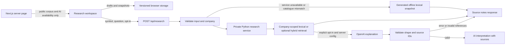

# Research workspace — implementation and learning guide

Implemented on 2026-10-16. This is a working local MVP with a curated corpus, not a validated financial product or a completed semantic-RAG platform.

## User journey

1. Choose NVIDIA, Microsoft or Apple in the sidebar.
2. Start with the business overview, then explore growth and risk topics. Source details open only when requested and can be closed to return to the topic.
3. Choose Save source to keep useful notes in Saved sources. A bookmark does not imply the user has understood or verified a claim.
4. Search a question or claim. Keyword retrieval stays within the selected company's notes. Current-price, unsupported-period and latest-information questions abstain.
5. Write in My notes in your own words: business, opportunity, risk, unknowns, change-of-mind conditions and optional personal context.
6. Choose Save to history to keep a copy. Drafts auto-save; the earlier history entry retains its text and evidence references.
7. Export a backup, inspect previous snapshots, or explicitly delete the company's notebook.

## Architecture

Next.js remains the public entry point. The existing Python service now provides independently testable, versioned retrieval; a generated offline snapshot preserves availability. See [system decisions and measured tradeoffs](research/2026-10-16-system-decisions.md) for why this additional service boundary was added and what it costs.

## Source boundaries

`backend/src/riskpilot/research/data/catalog.json` is the canonical catalogue; `companies.json` is its generated frontend snapshot. It contains 12 manually curated paraphrases from:

- [NVIDIA FY2025 10-K](https://www.sec.gov/Archives/edgar/data/1045810/000104581025000023/nvda-20250126.htm), fiscal year ended January 26, 2025; filed February 26, 2025.
- [Microsoft FY2025 Annual Report](https://www.microsoft.com/investor/reports/ar25/), fiscal year ended June 30, 2025; published July 30, 2025.
- [Apple FY2025 10-K](https://www.sec.gov/Archives/edgar/data/320193/000032019325000079/aapl-20250927.htm), fiscal year ended September 27, 2025; filed October 31, 2025.

Documents were checked on October 16, 2026. These periods are intentionally historical and are not represented as the latest filings. Selected notes are incomplete research context, not exhaustive risk disclosure or independent validation of company statements.

Search normalizes accents, drops common stopwords and ranks token overlap. Some Vietnamese keywords are included, but bilingual retrieval has not been comprehensively evaluated. Optional prebuilt embeddings and hybrid ranking are implemented behind explicit configuration/consent; their live quality is not yet evaluated. The system does not ingest arbitrary documents, browse the web or monitor new filings.

## Optional model boundary

The browser offers optional AI search and explanation only when `RESEARCH_LIVE_AI=1`, `OPENAI_API_KEY` and `OPENAI_MODEL` exist server-side. The default path makes no provider request.

Only the submitted question and selected public notes go to the provider. The endpoint rejects extra fields; it does not accept notebook text or journal history. Output source IDs must belong to the retrieved notes. Invalid IDs, malformed JSON, provider errors and timeout fall back to notes.

Reference checks do not validate entailment or every factual assertion. The UI labels generated content as AI interpretation and keeps source inspection available. No automated claim-truth classifier, stock recommendation, price prediction or readiness score is implemented.

The inference limiter is per process: at most two active provider requests and ten starts per minute. It is not distributed abuse protection. Public paid inference at scale needs shared limits and a deployment policy. No live paid model request was made during verification.

## Notebook boundary

- `notebook.ts`: Zod schema, source-ID cleaning, immutable snapshot creation and JSON export.
- `useResearchNotebook.ts`: initial load, cross-tab storage events, read-before-write mutations and quota/recovery handling.
- Records stay in browser localStorage. They do not sync between devices or form an authenticated account.
- Concurrent same-field edits use last-write-wins. Normal updates read the newest stored company record and preserve its other fields and journal.
- Snapshot history is not silently truncated. If browser quota is exhausted, the new draft stays in memory and the UI asks the user to export it.
- Unreadable saved data is not overwritten. The recovery panel exports the original payload and requires confirmation before reset.
- Browser/site-data deletion and shared browser profiles remain limits of this storage model. This is not a cloud backup or collaborative editor.

## How to learn from this build

Work through one boundary at a time. Explain the current behavior before changing it.

1. **React/UI:** Trace how selecting a company changes the map and evidence desk. Add one display-only field without copying the whole component.
2. **Types and validation:** Trace a notebook from textarea to schema and storage. Reproduce a malformed saved payload and inspect recovery behavior.
3. **Retrieval:** Run a direct, paraphrased and unanswerable query. Explain why the matching notes appear. Identify a failure before proposing embeddings.
4. **HTTP:** Follow the form request into `/api/research`; compare a valid request, unsupported company and extra private field.
5. **Concurrency:** Open two tabs. Edit different company notebooks, then the same field. Explain reconciliation and last-write-wins.
6. **Model reliability:** With mocked provider responses, compare valid IDs, invented IDs and timeout. Explain what reference validation proves and what it cannot prove.
7. **Product research:** Observe a beginner explaining the company after use. Compare their words with source evidence, not with the fluency of the AI output.

## What still needs research or implementation

- User interviews, usability comparison against a chat summary, retention and willingness-to-pay validation.
- A larger human-reviewed retrieval/grounding evaluation corpus.
- Full-document ingestion and structural chunking; live embedding evaluation against real research questions. A 30-case authored lexical diagnostic and optional embedding adapter now exist.
- Freshness monitoring and meaningful comparison between reporting periods.
- Authenticated account storage, access control and cloud sync if repeat usage justifies them.

These remain roadmap items. The current build does not claim to have completed them.

## Interactive dependency and risk memo milestone — 2026-10-17

Revenue percentages, bar categories and legend entries now open a native dependency dialog. Reviewed links show growth context and selected risk disclosures with explicit company-wide/category scope. Users can classify a risk as Dealbreaker, Manageable risk or Blindspot and add their own reason in My notes. The labels are personal judgments, not AI-generated recommendations or measured probabilities.

Risk assessments capture the source summary, URL, period, section and catalogue version. Old notebooks/snapshots receive an empty default assessment collection; existing prose is retained. History clones nested captured-source data. A retired source can remain in a captured assessment, and classification removal leaves separately saved evidence available. Markdown export contains user classifications, reasons and captured provenance; JSON backup still includes full history. All remain browser-local and editable by the browser owner.

See the [Vietnamese code walkthrough](../learning/02-risk-memo/README.md) and [milestone plan](superpowers/plans/2026-10-17-interactive-research-learning.md). No database migration, external telemetry, public sharing or new model inference was added by this milestone. Source pinning/highlight, cross-company comparisons, command navigation and case-study annotations remain planned work.
