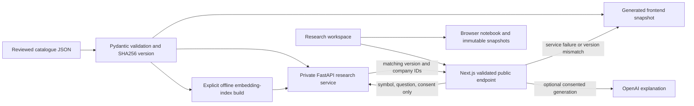

# RiskPilot research system: decisions and tradeoffs

Implemented 2026-10-16. This milestone adds a service boundary, reproducible data maintenance and retrieval evaluation to the existing workspace. It does not establish product-market fit or investment outcomes.

## What runs



No notebook content is forwarded by the application. Anything a person explicitly types into the research question is submitted as a question, so users should avoid including private information there. The private service uses the existing shared secret. Neither backend URL nor secret is sent to the browser.

## Decisions

| Decision | Benefit for this project | Cost / failure mode | Reconsider when |
|---|---|---|---|
| Reuse FastAPI for research; keep Next.js as the public entry | Retrieval can be tested independently; reuses the Python environment instead of creating another service | Additional HTTP hop and two processes to debug; a single Next.js app would be simpler for the current dataset | If service maintenance overwhelms learning/user value, move retrieval back behind the same Next.js contract |
| Start with 12 reviewed historical notes, not automatic full-filing crawling | Source scope, dates and provenance are inspectable; small enough for a learner to understand every record | Coverage is very limited; manual summaries can omit relevant context and require human review | Real user questions repeatedly need missing disclosures; then ingest original filings with section-aware chunks and evaluated citations |
| Generate an offline snapshot from the canonical catalogue | Demo and notebooks remain usable when Python is down | Duplicated artifact and a second lexical implementation; mismatched versions force offline mode, potentially hiding newly added notes | Availability no longer requires offline demo; replace mirror with a versioned service catalogue and migration strategy |
| Content hash both catalogue and embedding index | Rejects stale content/model combinations before a paid query | Even metadata changes require index rebuilding; pinned catalogue requires a process restart after edits | Catalogue gets large enough to need per-document incremental indexing |
| Ship lexical baseline plus an optional hybrid adapter | Default search is free, predictable and reproducible; embeddings can be evaluated against a known weakness | Lexical paraphrase recall is poor; hybrid adds provider cost, delay and another failure boundary | A real embedding evaluation demonstrates gains without unacceptable false matches/cost |
| Store 12 vectors in a local JSON index, rank in memory | No vector database/account/operational setup; straightforward inspection and tests | Linear scan and index loading per request; unsuitable for a large corpus or multiple independent replicas | Measured latency, catalogue size or update frequency warrants a shared vector store |
| Build document embeddings explicitly, embed only an opted-in question at runtime | Catalogue maintenance is separate from user requests; no surprise automatic paid build | Someone must regenerate the index; semantic search can remain unavailable until configured | Build/update reliability needs durable ingestion jobs and incremental indexes |
| Filter company/period before ranking; abstain on unsupported scope | Reduces cross-company and historical/current mixups | Regex boundaries are conservative and incomplete; related notes can still appear for unanswerable detailed questions | Larger annotated scope/answerability set supports a better router or classifier |
| Keep guided research and user-authored reasoning | User can inspect evidence and record what would change their mind | More effort than a fluent instant answer; understanding/retention improvement remains a product hypothesis | Interviews and observed usability show where users abandon or misunderstand the flow |
| Keep notebook memory local | No account/database setup and notebook text is excluded from provider requests | No cloud backup/device sync/access controls; same-field concurrent edits are last-write-wins | Repeat users demonstrate a need for cross-device memory and accept account setup |

Hybrid search combines token-overlap and cosine rankings using reciprocal-rank fusion. It does not add incomparable raw scores. The constant 60 and cosine cutoff 0.35 are initial heuristics, not calibrated confidence or proof of answerability. References: [Elastic RRF documentation](https://www.elastic.co/docs/reference/elasticsearch/rest-apis/reciprocal-rank-fusion), [OpenAI embedding documentation](https://developers.openai.com/api/docs/guides/embeddings). No claim that this hybrid configuration is optimal.

## Measured baseline

The [machine-readable report](retrieval-baseline-2026-10-16.json) contains every query, expected note, retrieved IDs and failure. These are authored development diagnostics against the existing notes, not an independent held-out benchmark.

| Category | Passing / cases | Pass definition |
|---|---:|---|
| Direct wording | 10 / 10 | At least one expected note appears in top 3 |
| Paraphrased wording | 2 / 10 | At least one expected note appears in top 3 |
| Unsupported scope/time | 5 / 5 | No notes returned |
| Unanswerable from selected notes | 4 / 5 | No notes returned |

Example failure: “Who actually fabricates its processors?” returns no note, despite a manufacturing note existing. “exact China revenue percentage” returns related notes that do not contain that exact figure. The interface presents notes to inspect rather than treating a match as a verified answer, but answerability remains unresolved. Embeddings may improve paraphrases while worsening false positives; measure both before enabling broadly. The semantic branch was tested with synthetic vectors and provider failures, not live provider embeddings. AI-generated interpretation quality is not measured by this report.

## Reproduce and maintain

From `backend/`, with the existing virtual environment:

```bash
.venv/bin/python -m riskpilot.research.cli validate
.venv/bin/python -m riskpilot.research.cli export --output ../frontend/src/lib/research/companies.json
.venv/bin/python -m riskpilot.research.cli export --check --output ../frontend/src/lib/research/companies.json
.venv/bin/python -m riskpilot.research.cli evaluate --output ../docs/research/retrieval-baseline-2026-10-16.json
.venv/bin/python -m pytest -q
```

Edit `backend/src/riskpilot/research/data/catalog.json`, validate/export, inspect changed summaries and dates, rerun evaluation, then restart Python. Export/index writes replace artifacts atomically. The frontend snapshot must be regenerated before rebuilding Next.js. Tests fail if the committed snapshot diverges from the catalogue. This is catalogue ingestion/validation, not automatic source downloading or full-document chunking.

Optional semantic setup, deliberately not run during this milestone:

1. Set `OPENAI_API_KEY` and `RESEARCH_EMBEDDING_MODEL` to a supported embedding model.
2. Explicitly build with `.venv/bin/python -m riskpilot.research.cli index --with-embeddings --output .research/index.json`. This sends public catalogue notes to the provider and can incur charges.
3. On Python set `RESEARCH_SEMANTIC_ENABLED=1` and `RESEARCH_INDEX_PATH` to that file. Relative paths resolve from Python's working directory. Use an absolute path outside local development.
4. On Next.js configure `RESEARCH_LIVE_AI=1`, `OPENAI_API_KEY`, `OPENAI_MODEL` and the matching backend URL/secret. The existing UI checkbox opts into both semantic query search (if configured) and explanation. A separate semantic-only control is not implemented.
5. An unchecked checkbox uses lexical search even with a configured index. Missing/stale/incompatible indexes and provider errors fall back to lexical search. No index is automatically rebuilt by an HTTP request.

`RESEARCH_BACKEND_ENABLED=0` forces the bundled library. Otherwise Next.js attempts the private service; lexical requests have a 1.2-second service timeout, opted-in semantic requests 10 seconds, and optional explanation a separate 20-second timeout. Timeouts may degrade to lexical rather than cancel work already running in Python. The Python provider itself has an 8-second timeout and no retries. Both paid boundaries have per-process concurrency/start limits (2 active, 10 per minute), not distributed production abuse protection.

## Learning and interview story

Build the story around a failure and a measured decision: “A fluent answer can hide missing evidence. I separated the notebook, source catalogue, retriever and explanation. I measured paraphrase failures, kept a free baseline, versioned the index, and made service/provider failure visible.”

Reproduce three failures yourself before extending the system: stop Python and inspect the offline status; change a catalogue summary without regenerating the snapshot and observe version rejection; query an exact figure absent from the notes and explain why related retrieval is insufficient. These are concrete system-design lessons without adding financial modelling.

Next technical milestone: annotate real anonymized research questions and evaluate a real embedding index versus this baseline. Next product milestone: observe beginners using the evidence/understanding flow. Do not substitute test counts or a polished interface for evidence of willingness to pay.

## Verification recorded

121 backend tests, 107 frontend unit/API tests and 23 selected browser tests passed. The isolated Next.js production build passed. Production browser smoke exercised the actual Next.js → private Python request and offline fallback after stopping Python, with no page errors or mobile horizontal overflow. Catalogue and diagnostic export checks passed byte-for-byte. Scoped Python lint passed. Code review confirmed the corrected online/offline price-boundary mismatch and semantic opt-in/configuration/stale-index tests. No live paid calls or deployment were performed.
